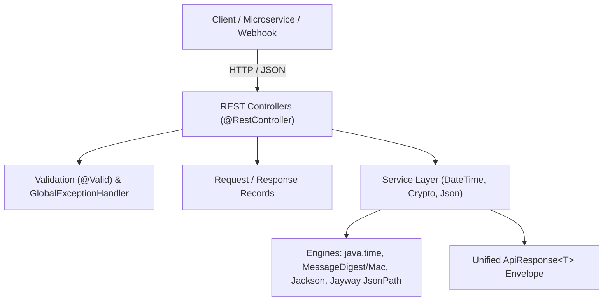

# 🛠️ Util Tools REST API Server

[](https://openjdk.org/projects/jdk/21/)
[-brightgreen.svg?logo=springboot)](https://spring.io/projects/spring-boot)
[-success.svg)](https://junit.org/junit5/)
[](http://localhost:8080/swagger-ui/index.html)
[](LICENSE)

A high-performance, lightweight, developer-focused utility REST API server built from scratch with **Java 21** and **Spring Boot 4**.

It packs the **3 most useful daily developer utility tools** into clean, predictable, production-grade HTTP APIs with interactive Swagger/OpenAPI 3 documentation, unified response envelopes, and comprehensive automated test coverage.

---

## 📑 Table of Contents

- [The 3 Core Utility Tools](#-the-3-core-utility-tools)
- [Architecture & Tech Stack](#-architecture--tech-stack)
- [Project Directory Structure](#-project-directory-structure)
- [API Endpoints Reference](#-api-endpoints-reference)
- [Detailed Endpoint Guides & Examples](#-detailed-endpoint-guides--examples)
  - [1. DateTime & Timezone Utility](#1-datetime--timezone-utility)
  - [2. Cryptography & Encoding Utility](#2-cryptography--encoding-utility)
  - [3. JSON & Data Processor Utility](#3-json--data-processor-utility)
- [Operation Journal & Replay Verification](#-operation-journal--replay-verification)
- [Unified Response & Error Handling](#-unified-response--error-handling)
- [Interactive API Documentation (Swagger UI)](#-interactive-api-documentation-swagger-ui)
- [Quick Start Guide](#-quick-start-guide)
  - [Prerequisites](#prerequisites)
  - [Run with Maven Wrapper](#run-with-maven-wrapper)
  - [Run with Packaged JAR](#run-with-packaged-jar)
  - [Run with Docker](#run-with-docker)
- [Automated Testing](#-automated-testing)

---

## 🎯 The 3 Core Utility Tools

| Tool | Base Path | Core Capabilities |
| :--- | :--- | :--- |
| **🕒 DateTime & Timezone** | `/api/v1/utils/datetime` | Epoch seconds/millis ⇄ ISO-8601 conversion, IANA timezone shifts, duration diff calculation, current global time |
| **🔐 Crypto & Encoding** | `/api/v1/utils/crypto` | SHA-256, SHA-512, MD5, SHA-1 digests, HMAC keyed signatures, Base64 & URL-safe Base64 encode/decode, UUID v4 batch generation |
| **📄 JSON Data Processor** | `/api/v1/utils/json` | JSON formatting/pretty-printing, minification, syntax validation with line/column error diagnostics, JSONPath query evaluation |

---

## 🏗 Architecture & Tech Stack



- **Language**: **Java 21 LTS** (Records, Pattern Matching, Modern `java.time`, Modern Stream APIs, `HexFormat`)
- **Framework**: **Spring Boot 4** (`spring-boot-starter-web`, `spring-boot-starter-validation`)
- **JSON Processing**: Jackson (`ObjectMapper`) & Jayway `json-path`
- **Documentation**: OpenAPI 3.0 & Swagger UI (`springdoc-openapi-starter-webmvc-ui`)
- **Testing**: JUnit 5, MockMvc, AssertJ (100% test pass rate across 32 unit and integration tests)

---

## 📂 Project Directory Structure

```text
utiltools_api/
├── pom.xml                                    # Maven dependencies & build config
├── mvnw / mvnw.cmd                            # Embedded Maven Wrapper
├── Dockerfile                                 # Multi-stage production container build
├── docs/
│   └── superpowers/
│       ├── specs/                             # Design specification
│       └── plans/                             # TDD Implementation plan
└── src/
    ├── main/
    │   ├── java/com/example/utiltools/
    │   │   ├── UtiltoolsApiApplication.java   # Spring Boot Application entrypoint
    │   │   ├── common/                        # Shared infrastructure
    │   │   │   ├── ApiResponse.java           # Unified JSON envelope
    │   │   │   ├── ErrorResponse.java         # Standard error model
    │   │   │   └── GlobalExceptionHandler.java# Centralized exception handling
    │   │   ├── config/
    │   │   │   └── OpenApiConfig.java         # Swagger UI & OpenAPI 3 metadata
    │   │   ├── datetime/                      # Tool 1: DateTime & Timezone
    │   │   │   ├── controller/DateTimeController.java
    │   │   │   ├── service/DateTimeService.java
    │   │   │   └── dto/
    │   │   ├── crypto/                        # Tool 2: Cryptography & Encoding
    │   │   │   ├── controller/CryptoController.java
    │   │   │   ├── service/CryptoService.java
    │   │   │   └── dto/
    │   │   └── json/                          # Tool 3: JSON Data Processor
    │   │       ├── controller/JsonController.java
    │   │       ├── service/JsonService.java
    │   │       └── dto/
    │   └── resources/
    │       └── application.properties         # Server & Swagger configuration
    └── test/java/com/example/utiltools/
        ├── UtiltoolsApiApplicationTests.java
        ├── common/GlobalExceptionHandlerTest.java
        ├── datetime/
        │   ├── DateTimeControllerTest.java
        │   └── DateTimeServiceTest.java
        ├── crypto/
        │   ├── CryptoControllerTest.java
        │   └── CryptoServiceTest.java
        └── json/
            ├── JsonControllerTest.java
            └── JsonServiceTest.java
```

---

## ⚡ API Endpoints Reference

| Method | Endpoint | Description |
| :--- | :--- | :--- |
| `POST` | `/api/v1/utils/datetime/convert` | Convert epoch timestamp or ISO string to target timezone & pattern |
| `POST` | `/api/v1/utils/datetime/diff` | Calculate duration & difference between two datetime points |
| `GET` | `/api/v1/utils/datetime/current` | Fetch current time in UTC and target timezone |
| `POST` | `/api/v1/utils/crypto/hash` | Compute cryptographic digest (SHA-256, SHA-512, MD5) or HMAC |
| `POST` | `/api/v1/utils/crypto/base64` | Encode or decode standard / URL-safe Base64 strings |
| `GET` | `/api/v1/utils/crypto/uuid` | Generate random UUID v4 list (standard or compact 32-hex) |
| `POST` | `/api/v1/utils/json/format` | Pretty-print or minify JSON strings |
| `POST` | `/api/v1/utils/json/validate` | Check JSON syntax validity and report exact syntax error line/col |
| `POST` | `/api/v1/utils/json/query` | Evaluate JSONPath queries and extract matching nodes |
| `GET` | `/api/v1/utils/audit/entries` | List journal entries (newest first) with optional `limit` & `state` filters |
| `GET` | `/api/v1/utils/audit/entries/{id}` | Fetch a single journal entry (redacted request/result) |
| `POST` | `/api/v1/utils/audit/entries/{id}/replay` | Replay a deterministic SUCCEEDED entry and verify the outcome |

---

## 📖 Detailed Endpoint Guides & Examples

### Standard Response Format
Every endpoint returns a unified JSON envelope:
```json
{
  "success": true,
  "message": "Operation successful",
  "data": { ... },
  "requestId": "9f3c1a7e-5b2d-4c8a-9e10-2f6d4b8a1c33",
  "timestamp": "2026-10-31T00:50:38.707903775Z"
}
```

Every response — success **and** error — carries the correlation id of the request in both
the `X-Request-Id` response header and the `requestId` envelope field. Send your own
`X-Request-Id` (8–64 chars of `A-Z a-z 0-9 _ -`) to keep your own trace id, otherwise the
server generates a UUID.

---

### 1. DateTime & Timezone Utility

#### A. Convert Datetime Across Timezones
Supports:
- Epoch milliseconds (e.g., `1730335200000`)
- Epoch seconds (e.g., `1730335200`)
- ISO-8601 strings (e.g., `2026-01-01T15:00:00Z`)
- Target IANA timezones (e.g., `Asia/Tokyo`, `America/New_York`, `Europe/London`, `UTC`)
- Optional custom formatting pattern (e.g., `yyyy-MM-dd HH:mm:ss`)

```bash
curl -X POST http://localhost:8080/api/v1/utils/datetime/convert \
  -H "Content-Type: application/json" \
  -d '{
    "input": "1730335200000",
    "targetTimeZone": "Asia/Tokyo",
    "customPattern": "yyyy-MM-dd HH:mm:ss"
  }'
```

**Response:**
```json
{
  "success": true,
  "message": "DateTime converted successfully",
  "data": {
    "epochMillis": 1730335200000,
    "epochSeconds": 1730335200,
    "isoUtc": "2024-10-31T00:40:00Z",
    "targetTimeZone": "Asia/Tokyo",
    "formattedTarget": "2024-10-31 09:40:00"
  },
  "timestamp": "2026-10-30T16:50:38.707903775Z"
}
```

#### B. Calculate Difference Between Two Datetimes
Computes days, total hours, total minutes, total seconds, milliseconds, and human-readable text.

```bash
curl -X POST http://localhost:8080/api/v1/utils/datetime/diff \
  -H "Content-Type: application/json" \
  -d '{
    "start": "2026-01-01T00:00:00Z",
    "end": "2026-01-03T12:30:00Z"
  }'
```

**Response:**
```json
{
  "success": true,
  "message": "DateTime difference calculated successfully",
  "data": {
    "days": 2,
    "hours": 60,
    "minutes": 3630,
    "seconds": 217800,
    "millis": 217800000,
    "humanReadable": "2 days 12 hours 30 minutes 0 seconds"
  },
  "timestamp": "2026-10-30T16:50:38.765157734Z"
}
```

#### C. Get Current Global Time
```bash
curl "http://localhost:8080/api/v1/utils/datetime/current?timeZone=Asia/Taipei"
```

**Response:**
```json
{
  "success": true,
  "message": "Current time retrieved successfully",
  "data": {
    "epochMillis": 1793379038802,
    "epochSeconds": 1793379038,
    "utc": "2026-10-30T16:50:38.802177453Z",
    "local": "2026-10-31T00:50:38.802177453+08:00",
    "timeZone": "Asia/Taipei"
  },
  "timestamp": "2026-10-30T16:50:38.802324893Z"
}
```

---

### 2. Cryptography & Encoding Utility

#### A. Standard Hash Digest (SHA-256)
Supported algorithms: `SHA-256`, `SHA-512`, `MD5`, `SHA-1` (case-insensitive).

```bash
curl -X POST http://localhost:8080/api/v1/utils/crypto/hash \
  -H "Content-Type: application/json" \
  -d '{
    "algorithm": "SHA-256",
    "content": "Hello World"
  }'
```

**Response:**
```json
{
  "success": true,
  "message": "Hash generated successfully",
  "data": {
    "algorithm": "SHA-256",
    "digest": "a591a6d40bf420404a011733cfb7b190d62c65bf0bcda32b57b277d9ad9f146e",
    "isHmac": false
  },
  "timestamp": "2026-10-30T16:50:38.834878322Z"
}
```

#### B. HMAC-SHA256 Signature
Include `secretKey` to automatically compute a keyed HMAC signature:

```bash
curl -X POST http://localhost:8080/api/v1/utils/crypto/hash \
  -H "Content-Type: application/json" \
  -d '{
    "algorithm": "SHA-256",
    "content": "Hello World",
    "secretKey": "my-secret"
  }'
```

**Response:**
```json
{
  "success": true,
  "message": "Hash generated successfully",
  "data": {
    "algorithm": "HmacSHA256",
    "digest": "820254804a971bc380e5f4d44177fdf729c70386997e8b901b7a83054d4043b9",
    "isHmac": true
  },
  "timestamp": "2026-10-30T16:50:38.870474141Z"
}
```

#### C. Base64 Encode / Decode
```bash
# Encode
curl -X POST http://localhost:8080/api/v1/utils/crypto/base64 \
  -H "Content-Type: application/json" \
  -d '{
    "action": "ENCODE",
    "content": "Hello World",
    "urlSafe": false
  }'

# Decode
curl -X POST http://localhost:8080/api/v1/utils/crypto/base64 \
  -H "Content-Type: application/json" \
  -d '{
    "action": "DECODE",
    "content": "SGVsbG8gV29ybGQ="
  }'
```

**Response:**
```json
{
  "success": true,
  "message": "Base64 operation completed successfully",
  "data": {
    "action": "ENCODE",
    "result": "SGVsbG8gV29ybGQ="
  },
  "timestamp": "2026-10-30T16:50:38.923723150Z"
}
```

#### D. UUID Generator
Query parameters:
- `count` (optional, default `1`, max `100`)
- `compact` (optional, default `false`; when `true`, removes hyphens into 32-hex chars)

```bash
curl "http://localhost:8080/api/v1/utils/crypto/uuid?count=2&compact=true"
```

**Response:**
```json
{
  "success": true,
  "message": "UUIDs generated successfully",
  "data": {
    "count": 2,
    "uuids": [
      "3776d0fbdbf94a999a7b029b588ecb47",
      "cb0151c680c24c63a26d1f5a013ad079"
    ]
  },
  "timestamp": "2026-10-30T16:50:38.954060989Z"
}
```

---

### 3. JSON & Data Processor Utility

#### A. Format / Pretty-Print or Minify JSON
`indent` is optional: it must be an integer in **1-8**, defaults to **2** spaces per nesting level when omitted, and is ignored when `minify` is `true`. Values outside 1-8 are rejected with HTTP 400 and `error` `VALIDATION_ERROR`.

```bash
curl -X POST http://localhost:8080/api/v1/utils/json/format \
  -H "Content-Type: application/json" \
  -d '{
    "json": "{\"user\":{\"id\":101,\"name\":\"Alice\"}}",
    "minify": false,
    "indent": 4
  }'
```

**Response:**
```json
{
  "success": true,
  "message": "JSON formatted successfully",
  "data": {
    "formattedJson": "{\n    \"user\" : {\n        \"id\" : 101,\n        \"name\" : \"Alice\"\n    }\n}",
    "sizeBytes": 69
  },
  "timestamp": "2026-10-30T16:50:38.987061888Z"
}
```

#### B. Validate JSON Syntax
Accurately detects structural issues and pinpoint exact line & column errors:

```bash
curl -X POST http://localhost:8080/api/v1/utils/json/validate \
  -H "Content-Type: application/json" \
  -d '{
    "json": "{\"user\": 123"
  }'
```

**Response:**
```json
{
  "success": true,
  "message": "JSON syntax is invalid",
  "data": {
    "valid": false,
    "error": "Unexpected end-of-input: expected close marker for Object",
    "line": 1,
    "column": 13,
    "type": null
  },
  "timestamp": "2026-10-30T16:50:39.009667747Z"
}
```

#### C. Query with JSONPath
```bash
curl -X POST http://localhost:8080/api/v1/utils/json/query \
  -H "Content-Type: application/json" \
  -d '{
    "json": "{\"users\":[{\"name\":\"Alice\"},{\"name\":\"Bob\"}]}",
    "jsonPath": "$.users[*].name"
  }'
```

**Response:**
```json
{
  "success": true,
  "message": "JSONPath executed successfully",
  "data": {
    "jsonPath": "$.users[*].name",
    "result": [
      "Alice",
      "Bob"
    ]
  },
  "timestamp": "2026-10-30T16:50:39.127057574Z"
}
```

---

## 🧾 Operation Journal & Replay Verification

Every `/api/v1/utils/**` call is recorded in a **bounded in-memory journal** so a failed hash,
JSON query, or datetime conversion leaves a trace of what actually executed, and a retry can be
verified against the original outcome without ever mutating the original entry.

**Lifecycle:** `PENDING` on entry → `SUCCEEDED` with the response DTO, or `FAILED` with an
`errorCode` (`BAD_REQUEST` / `INTERNAL_SERVER_ERROR`). Only `PENDING → SUCCEEDED` and
`PENDING → FAILED` are legal; late or duplicate transitions throw `IllegalStateException`.

**Bounds:** the journal keeps at most `utiltools.audit.max-entries` entries (default `200`,
oldest evicted first).

**Redaction:** in every response the request view replaces the *values* of the secret fields
`secretKey`, `secret`, `password`, `token` and `authorization` (matched case-insensitively, at any
depth) with `"***"`. Field names are preserved and every other field — including `content`,
`json`, `input` and `timeZone` — is echoed verbatim, so avoid putting secrets in non-secret fields.
The raw request is stored privately for replay and is never serialized by `list`, `find` or
`replay`.

**Oversized payloads:** a request whose JSON exceeds `utiltools.audit.max-replay-bytes` (default
`65536`) is **not retained** — the entry keeps only an `omitted` marker instead of the payload and
is flagged `"replayable": false`, so replaying it answers `409 REPLAY_CONFLICT`.

### A. List journal entries

```bash
curl "http://localhost:8080/api/v1/utils/audit/entries?limit=5&state=FAILED"
```
```json
{
  "success": true,
  "message": "Audit entries retrieved successfully",
  "data": [
    {
      "id": "0f4f1f0e9c8b4d7e",
      "requestId": "corr-crypto5678",
      "operation": "CRYPTO_HASH",
      "state": "FAILED",
      "createdAt": "2026-10-31T00:51:02.114Z",
      "completedAt": "2026-10-31T00:51:02.119Z",
      "request": { "algorithm": "NOPE-1", "content": "Hello World", "secretKey": "***" },
      "result": null,
      "errorCode": "BAD_REQUEST",
      "replayable": true,
      "replay": null
    }
  ],
  "requestId": "corr-crypto5678",
  "timestamp": "2026-10-31T00:51:02.121Z"
}
```

`state` accepts `PENDING`, `SUCCEEDED`, `FAILED` (omit for all); `limit` is clamped to the
configured bound. Any other `state` value or a non-numeric `limit` answers `400 BAD_REQUEST` in the
standard envelope rather than `500`.

### B. Fetch a single entry

```bash
curl "http://localhost:8080/api/v1/utils/audit/entries/0f4f1f0e9c8b4d7e"
```

Unknown ids return `404 NOT_FOUND`.

### C. Replay & verify an entry

```bash
curl -X POST "http://localhost:8080/api/v1/utils/audit/entries/3b7d9f2a1c5e4a60/replay"
```
```json
{
  "success": true,
  "message": "Replay verification completed",
  "data": {
    "id": "3b7d9f2a1c5e4a60",
    "operation": "CRYPTO_HASH",
    "state": "SUCCEEDED",
    "completedAt": "2026-10-31T00:51:02.119Z",
    "result": { "algorithm": "SHA-256", "digest": "a591a6d40bf420404a011733cfb7b190d62c65bf0bcda32b57b277d9ad9f146e", "isHmac": false },
    "replay": {
      "state": "VERIFIED",
      "replayedAt": "2026-10-31T00:52:10.004Z",
      "detail": "results match"
    }
  },
  "requestId": "corr-audit12345",
  "timestamp": "2026-10-31T00:52:10.007Z"
}
```

Replay re-invokes the original service with the privately stored request, compares the JSON of
the new result against the stored result, and records `VERIFIED` or `MISMATCH`. Only
`SUCCEEDED` **deterministic** entries (all operations except `DATETIME_CURRENT` and
`CRYPTO_UUID`) of replayable size can be replayed. The original `state`, `result`, and
`completedAt` are never rewritten — only the attached `replay` record is added. Any other case
returns `409 REPLAY_CONFLICT`.

---

## 🛡 Unified Response & Error Handling

When client input fails validation or business rules, `@RestControllerAdvice` formats a clean, standardized error response:

```json
{
  "success": false,
  "message": "Validation failed",
  "error": "VALIDATION_ERROR",
  "details": [
    "algorithm is required (e.g., SHA-256, SHA-512, MD5)",
    "content to hash is required"
  ],
  "timestamp": "2026-10-31T00:50:00Z"
}
```

| HTTP Status | Error Code | Trigger Condition |
| :--- | :--- | :--- |
| `400 BAD_REQUEST` | `VALIDATION_ERROR` | Missing required fields (`@NotBlank`, `@NotNull`, etc.) |
| `400 BAD_REQUEST` | `BAD_REQUEST` | Invalid timezone ID, unsupported hash algorithm, corrupt Base64 |
| `400 BAD_REQUEST` | `BAD_REQUEST` | Malformed HTTP request body |
| `404 NOT_FOUND` | `NOT_FOUND` | Unknown audit journal entry id |
| `409 CONFLICT` | `REPLAY_CONFLICT` | Replay of a FAILED, non-deterministic, oversized, or still-PENDING entry |
| `500 INTERNAL_SERVER_ERROR` | `INTERNAL_SERVER_ERROR` | Unhandled runtime exception |

---

## 📖 Interactive API Documentation (Swagger UI)

Interactive Swagger UI and OpenAPI documentation are enabled out-of-the-box:

- **Swagger UI**: [http://localhost:8080/swagger-ui/index.html](http://localhost:8080/swagger-ui/index.html)
- **OpenAPI 3 JSON Specification**: [http://localhost:8080/v3/api-docs](http://localhost:8080/v3/api-docs)

You can explore endpoints, inspect schemas, and test API calls directly inside your web browser.

---

## 🚀 Quick Start Guide

### Prerequisites
- **JDK 21** or later
- **Maven 3.8+** (or use the pre-packaged `./mvnw`)

### Run with Maven Wrapper
```bash
# Clone or navigate to the directory
cd /home/aiteam/sample/utiltools_api

# Run application
./mvnw spring-boot:run
```

### Run with Packaged JAR
```bash
# Package the application
./mvnw clean package

# Run the standalone executable JAR
java -jar target/utiltools-api-0.0.1-SNAPSHOT.jar
```

### Run with Docker
A multi-stage [`Dockerfile`](Dockerfile) is included for container deployments:

```bash
# Build the Docker image
docker build -t utiltools-api:latest .

# Run the container
docker run -d -p 8080:8080 --name utiltools-api utiltools-api:latest
```

---

## 🧪 Automated Testing

The project is built with Test-Driven Development (TDD) using JUnit 5, MockMvc, and AssertJ:

```bash
./mvnw clean test
```

### Test Suite Summary:
- **`DateTimeServiceTest`**: Epoch parsing, timezone shifts, duration math, boundary checks.
- **`DateTimeControllerTest`**: Full HTTP endpoint testing with MockMvc.
- **`CryptoServiceTest`**: Standard hashing vectors, HMAC calculations, Base64 encode/decode, UUID generation.
- **`CryptoControllerTest`**: HTTP validation and crypto response envelope testing.
- **`JsonServiceTest`**: Formatting, minification, Jackson parsing error positions, JSONPath queries.
- **`JsonControllerTest`**: JSON endpoints MockMvc test suite.
- **`GlobalExceptionHandlerTest`**: Centralized error mapping and constraint validation verification.
- **`UtiltoolsApiApplicationTests`**: Spring ApplicationContext loading verification.
