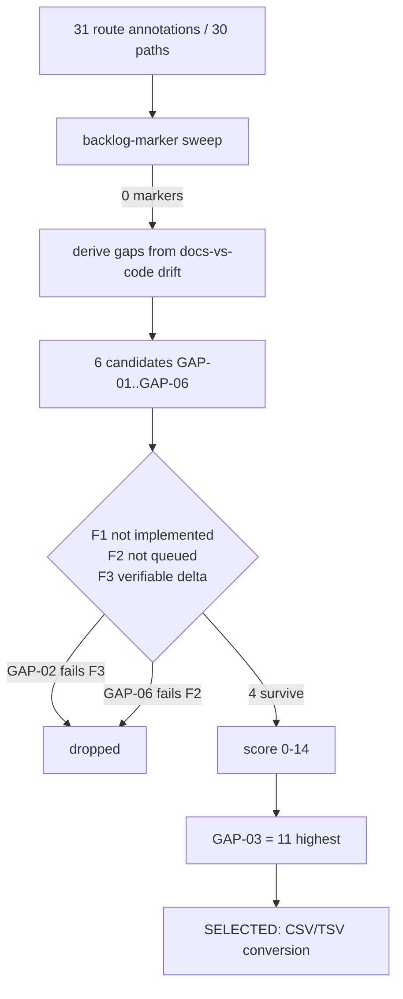

# UtilTools — Next Implementation Task (Discovery Report)

**Task:** UTILTOOLS-42 · **Plan:** `Implementation_Plan.md` v1.1 (Complexity Tier S) · **Gate:** `tools/check_discovery_report.sh`
**Requirements covered:** REQ-01 (structure + patterns), REQ-02 (identify a candidate), REQ-03 (not already implemented, not queued)
**Outcome:** every production package inventoried, the house conventions catalogued, candidate gaps scored, one selected → **GAP-03 — CSV/TSV ⇄ JSON conversion**.

This document is a *report*, not an implementation. No file under `src/main`, `src/test`, `pom.xml`, `README.md` or `.ait/` is modified by this task; the only two artifacts are this report and the gate script `tools/check_discovery_report.sh`.

## 1. Architecture inventory

- inventory: main-sources=100 pkg-dirs=10 test-dirs=10 mirrored=9 test-sources=30
- entry-point: src/main/java/com/example/utiltools/UtiltoolsApiApplication.java
- evidence: `printf 'main-sources=%s pkg-dirs=%s test-dirs=%s mirrored=%s test-sources=%s entry-point=%s\n' "$(find src/main/java/com/example/utiltools -name '*.java' | wc -l)" "$(find src/main/java/com/example/utiltools -mindepth 1 -maxdepth 1 -type d | wc -l)" "$(find src/test/java/com/example/utiltools -mindepth 1 -maxdepth 1 -type d | wc -l)" "$(c=0; for d in src/main/java/com/example/utiltools/*/; do [ -d "src/test/java/com/example/utiltools/$(basename "$d")" ] && c=$((c+1)); done; echo "$c")" "$(find src/test/java/com/example/utiltools -name '*.java' | wc -l)" "$(basename "$(find src/main/java/com/example/utiltools -maxdepth 1 -name '*Application.java')")"`
- exit: 0
- output: `main-sources=100 pkg-dirs=10 test-dirs=10 mirrored=9 test-sources=30 entry-point=UtiltoolsApiApplication.java`

A single request walks this pipeline, in this order, and every package below sits on one stage of it: `RequestIdFilter` assigns the request id and stamps it into the response envelope → `RateLimitFilter`, whose scope is `/api/v1/utils/*`, rejects an over-budget caller before any controller runs → the owning controller validates its record DTO and delegates → `AuditedOperations` / `AuditJournalService` journal every mutating operation → `CircuitBreaker` guards the outbound-side calls of `resilience` before the collaborator is reached. Steps that do not apply to a package are simply skipped, so the ordered chain is a description of the layers, not a claim that every route passes all five.

One Maven module (`pom.xml`, Java 21, Spring Boot 4, JUnit 5 + MockMvc + AssertJ). The inventory line above is the measured shape of the tree and is recomputed field by field by `tools/check_discovery_report.sh --inventory`, so no count in this section is a prose claim. Read it as: the entry point sits at the root of the package tree rather than inside a package — it is the only source file outside a package directory — and the package directories are mirrored almost one-for-one under `src/test/java/com/example/utiltools`, with `config` the single main package lacking a test counterpart because it holds springdoc wiring only; one test directory (`contact`) conversely has no main-source counterpart, and the application test sits at the test root, so the test-source figure is not the sum of the per-package test files.

The blocks below enumerate every package, its role, the HTTP surface it owns, and the shared code it depends on. Route counts are read off `@RequestMapping` + `@{Get,Post,Put,Patch,Delete}Mapping` annotations (`find src/main/java -name '*Controller.java'`), and every controller mapping resolves to a distinct path except `/jobs/{jobId}`, which `GET` and `DELETE` share.

### PKG-common
- path: src/main/java/com/example/utiltools/common
- role: cross-cutting HTTP plumbing — success envelope, error envelope, centralized exception mapping, request-id propagation, journal-lookup exceptions
- files: ApiResponse, ErrorResponse, GlobalExceptionHandler, RequestContext, RequestIdFilter, AuditEntryNotFoundException, ReplayConflictException
- endpoints: none of its own — `RequestIdFilter` wraps every `/api/v1/utils/*` request and stamps `requestId` into every envelope
- shared-dep: the whole API depends on it; `ApiResponse.success(...)` is the single return type of all 8 controllers, and `GlobalExceptionHandler` imports `resilience.CircuitBreakerOpenException` to map circuit trips to `503`

### PKG-config
- path: src/main/java/com/example/utiltools/config
- role: framework configuration — springdoc OpenAPI metadata only
- files: OpenApiConfig
- endpoints: none (no `@RestController`)
- shared-dep: springdoc reads the annotations placed on the controllers of every other package

### PKG-crypto
- path: src/main/java/com/example/utiltools/crypto
- role: hashing, Base64, URL encoding and UUID generation (stateless)
- files: CryptoController, CryptoService, Hash/Base64/Url/Uuid request+response records
- endpoints: `POST /api/v1/utils/crypto/hash`, `POST /api/v1/utils/crypto/base64`, `POST /api/v1/utils/crypto/url`, `GET /api/v1/utils/crypto/uuid`
- shared-dep: `audit.service.AuditedOperations` (3 journalled writes) and `common.ApiResponse`; the controller owns no journal code itself

### PKG-datetime
- path: src/main/java/com/example/utiltools/datetime
- role: epoch/ISO conversion, diffing, shifting, "now", and the timezone catalogue
- files: DateTimeController, DateTimeService, 5 request/response pairs plus TimeZoneInfo/TimeZoneListResponse
- endpoints: `POST /api/v1/utils/datetime/convert`, `/diff`, `/shift`, `GET /api/v1/utils/datetime/current`, `GET /api/v1/utils/datetime/timezones`
- shared-dep: `AuditedOperations` for the 4 journalled calls; `/timezones` is read-only and deliberately not journalled (README:1007)

### PKG-json
- path: src/main/java/com/example/utiltools/json
- role: the largest feature module — format, validate, query, flatten, unflatten, merge-patch and RFC 6902 patch, the last with a reverse-order rollback trail
- files: JsonController, JsonService, 11 request/response records, JsonPatchOperation, JsonPatchRollbackException
- endpoints: `POST /api/v1/utils/json/{format,validate,query,flatten,unflatten,merge-patch,patch}`
- shared-dep: `AuditedOperations` (6 journalled ops), `common.ApiResponse`, and — uniquely — `resilience.CircuitBreaker`, `CircuitBreakerConfig` and `resilience.AuditTrail` on the `/query` path

### PKG-jobs
- path: src/main/java/com/example/utiltools/jobs
- role: async batch-hash job lifecycle — submission, polling, listing, cancellation, retry, per-client quota and idempotency, backed by a bounded worker pool
- files: BatchJobController, BatchHashJobService, BatchHashRequest/Response, JobAttempt, JobStatus and 6 domain exceptions
- endpoints: `POST /api/v1/utils/jobs/hash`, `GET /api/v1/utils/jobs`, `GET /api/v1/utils/jobs/{jobId}`, `DELETE /api/v1/utils/jobs/{jobId}`, `POST /api/v1/utils/jobs/{jobId}/retry`
- shared-dep: `audit.service.AuditJournalService` + `audit.model.OperationType.BATCH_HASH` (best-effort journalling at worker admission), `ratelimit.ClientKeyResolver`, `ratelimit.RateLimitProperties`, `common.RequestContext`

### PKG-audit
- path: src/main/java/com/example/utiltools/audit
- role: the operation journal — bounded in-memory record of every journalled call, replay/claim state machine, payload redaction and oversized-payload omission
- files: AuditController, AuditJournalService, AuditReplayService, AuditedOperations, AuditEntry, OperationType, JournalState, ReplayState, ReplayClaim, ReplayRecord, ReapReason, ReapRecord, JournalVerifyRequest/Response/Result
- endpoints: `GET /api/v1/utils/audit/entries`, `GET /api/v1/utils/audit/entries/{id}`, `POST /api/v1/utils/audit/entries/{id}/replay`, `POST /api/v1/utils/audit/verify`
- shared-dep: `common.ApiResponse`, `common.AuditEntryNotFoundException`, `common.ReplayConflictException`; it is the *upstream* dependency of crypto, datetime, json, text and jobs

### PKG-resilience
- path: src/main/java/com/example/utiltools/resilience
- role: reusable circuit-breaker primitive (CLOSED/OPEN/HALF_OPEN) with an injection-friendly constructor and its own audit trail, demonstrated by two demo endpoints
- files: CircuitBreaker, CircuitBreakerConfig, CircuitState, CircuitTrigger, CircuitBreakerOpenException, AuditTrail, AuditEntry, ProbeRequest/Response, ResilienceConfig, ResilienceController
- endpoints: `GET /api/v1/utils/resilience` (state probe), `POST /api/v1/utils/resilience/probe`
- shared-dep: `common.ApiResponse`; consumed back by `json` (query) and `common.GlobalExceptionHandler`

### PKG-ratelimit
- path: src/main/java/com/example/utiltools/ratelimit
- role: sliding-window rate limiting — client key resolution, quota properties, response headers and a status endpoint
- files: RateLimitFilter, SlidingWindowRateLimiter, ClientKeyResolver, RateLimitProperties, RateLimitConfig, RateLimitHeaders, RateLimitStatusController, RateLimitStatusResponse
- endpoints: `GET /api/v1/utils/rate-limit/status` (class-level `@RequestMapping("/api/v1/utils")`)
- shared-dep: `common.ApiResponse`, and `jobs` reuses `ClientKeyResolver` + `RateLimitProperties` for its per-client job quota

### PKG-text
- path: src/main/java/com/example/utiltools/text
- role: string transformation (`UPPER/LOWER/TITLE/CAMEL/SNAKE/KEBAB/SLUG/SENTENCE_CASE`), literal replacement with counts, and text statistics
- files: TextController, TextService, TextTransform/TextReplace/TextStats request+response records
- endpoints: `POST /api/v1/utils/text/transform`, `POST /api/v1/utils/text/replace`, `POST /api/v1/utils/text/stats`
- shared-dep: `AuditedOperations` (3 journalled writes — including the failing-validation path exercised by `AuditTrailTest`) and `common.ApiResponse`

**Cross-package dependency shape:** `common` ← everything; `audit` ← {crypto, datetime, json, text, jobs}; `resilience` ← {json, common}; `ratelimit` ← {jobs, all routes via the filter}; feature packages never depend on each other.

## 2. Convention catalogue

The house patterns below were read off the code (not guessed). Each cites the file that establishes it.

1. **Package-by-feature, `controller`/`service`/`dto`-by-folder.** Every feature package has a controller at `controller/<Feature>Controller.java` (or the package root for `jobs`, `ratelimit`, `resilience`) and a stateless service holding the logic.
   - path: src/main/java/com/example/utiltools/json/service/JsonService.java
2. **Records for every DTO, request records carry Jakarta validation messages.** `@NotBlank(message = "text is required")` style, no annotations on response records.
   - path: src/main/java/com/example/utiltools/text/dto/TextTransformRequest.java
3. **Uniform success envelope.** All controllers return `ApiResponse<T>`; helpers are `success(data)` and `success(data, message)`, with `requestId` pulled from `RequestContext` and `timestamp` set at construction.
   - path: src/main/java/com/example/utiltools/common/ApiResponse.java
4. **Error envelope + one centralized handler with stable error codes.** `GlobalExceptionHandler` (`@RestControllerAdvice`) maps validation, domain and circuit-open failures to `ApiResponse.error(message, ERROR_CODE, details)`; example codes `PATCH_ROLLBACK`, `VALIDATION_ERROR`, `CIRCUIT_OPEN`.
   - path: src/main/java/com/example/utiltools/common/GlobalExceptionHandler.java
5. **Journal-then-execute.** Mutating utility calls are routed through `AuditedOperations`, which wraps the service call in `record(OperationType.X, request, supplier)` so a PENDING → SUCCEEDED/FAILED entry always brackets the work; controllers stay thin.
   - path: src/main/java/com/example/utiltools/audit/service/AuditedOperations.java
6. **`OperationType` is the journal vocabulary and the replay switch.** One enum constant per journalled operation; `AuditReplayService` dispatches on it, so a new journalled capability means a new constant plus a replay branch.
   - path: src/main/java/com/example/utiltools/audit/model/OperationType.java
7. **Resilience is injected, not static.** `CircuitBreakerConfig` is an immutable record; `CircuitBreaker` takes it plus a clock so tests advance time deterministically, and trips surface as `CircuitBreakerOpenException` → `503`.
   - path: src/main/java/com/example/utiltools/resilience/CircuitBreakerConfig.java
8. **Cross-cutting behaviour lives in servlet filters, never in controllers.** `RequestIdFilter` and `RateLimitFilter` are `OncePerRequestFilter`s scoped to `/api/v1/utils/*`; pure functions are kept in small package-private collaborators (`SlidingWindowRateLimiter`, `ClientKeyResolver`) so they are unit-testable without MockMvc.
   - path: src/main/java/com/example/utiltools/ratelimit/RateLimitFilter.java
9. **OpenAPI is written per route.** Every handler carries `@Operation(summary = ...)`; springdoc metadata is configured once in `OpenApiConfig`.
   - path: src/main/java/com/example/utiltools/json/controller/JsonController.java
10. **Tests come in pairs per module: service unit test + `@SpringBootTest`/MockMvc controller test.** Failure paths are asserted via `jsonPath("$.success")` and `$.error`.
    - path: src/test/java/com/example/utiltools/text/TextControllerTest.java
11. **Async work is a bounded queue with an explicit state machine.** `BatchHashJobService` owns the executor, quota, idempotency keys and a `JobStatus` FSM, and journals `BATCH_HASH` best-effort so audit state can never disagree with the job snapshot.
    - path: src/main/java/com/example/utiltools/jobs/BatchHashJobService.java
12. **Verification entry points are declared, not improvised.** The project fixates one canonical test command and timeout; discovery-side checks likewise belong in `tools/` as exit-code gates.
    - path: .ait/verify.toml

## 3. Gap register

### 3.1 TODO sweep

| Sweep | Command | Exit | Result |
| :--- | :--- | :-- | :----- |
| Code markers | `grep -rEnE 'TODO|FIXME|XXX|HACK' src/main README.md PROJECT_GOALS.md docs --exclude='2026-11-07-utiltools-next-implementation-task.md'` | 1 | **0 matches** — the codebase carries no inline backlog markers (the report is excluded from its own sweep because §3.1 and GAP-02 have to name the markers they look for) |
| Backlog headings | `grep -cE 'Roadmap|Backlog|Future work|Planned' README.md PROJECT_GOALS.md` | 1 | **0 matches** in both files; README's last H2 is "🧪 Automated Testing", there is no roadmap section |
| Forward-looking prose | `sed -n '1,20p' PROJECT_GOALS.md` | 0 | `PROJECT_GOALS.md` §1 "Continuous Tool Expansion" names *"data format conversion, text transformation, cryptographic helpers, validation, and encoding utilities"* as the intended growth axis — this is the only in-repo statement of intent |

Consequence: there is no literal backlog to lift a task from, so every candidate below is a **gap** derived from docs-vs-code drift or from an explicitly stated but unimplemented goal. The absence of markers is itself a candidate (GAP-02) and it is dropped at gate F3.

### 3.2 Gap register

Each block records the reproducing command, its exit code, the observed output, the three filters from the plan (F1 = not already implemented in `src/main`; F2 = not queued in `docs/superpowers/specs`, `docs/superpowers/plans` or README backlog prose; F3 = a delta exists that a future gate could verify), a blast-radius tier (S ≤3 files, M 4–10, L >10) and the 0–14 score.

### GAP-01: README endpoint table is stale: 5 shipped routes are missing
- evidence: `R=$(grep -cE '^[|] .(GET|POST|PUT|DELETE|PATCH). [|]' README.md); D=$(grep -E '^[|] .(GET|POST|PUT|DELETE|PATCH). [|]' README.md | cut -d'|' -f3 | tr -d ' `' | sort -u); T=$(awk -F'"' '/^@RequestMapping/{b=$2} /@(Get|Post|Put|Delete|Patch)Mapping/{p=(NF>1?$2:"/"); if(p=="/")p=""; sub(/\/$/,"",p); print b p}' $(find src/main/java -name '*Controller.java' | sort) | sort -u); M=$(printf '%s\n' "$T" | awk -v d="$D" 'BEGIN{n=split(d,a,"\n");for(i=1;i<=n;i++)if(a[i]!="")k[a[i]]=1}!($0 in k)'); S=$(printf '%s' "$M" | tr '\n' ' '); printf 'rows %s documented %s annotations %s routed %s\n' "$R" "$(printf '%s\n' "$D" | wc -l)" "$(grep -rhoE '@(Get|Post|Put|Delete|Patch)Mapping' src/main/java --include='*Controller.java' | wc -l)" "$(printf '%s\n' "$T" | wc -l)"; printf 'missing %s: %s\n' "$(printf '%s\n' "$M" | wc -l)" "${S% }"`
- exit: 0
- output: `missing 5: /api/v1/utils/json/flatten /api/v1/utils/json/unflatten /api/v1/utils/rate-limit/status /api/v1/utils/resilience /api/v1/utils/resilience/probe`
- gate: F1=PASS (all five are implemented, so the defect is documentation-only), F2=PASS (no spec/plan entry promises a table refresh), F3=PASS (distinct paths 25 → 30 is observable)
- tier: S — README.md only
- score: 9 (evidence 2, impact 1, blast 2, verifiability 1) — impact is 1, not 2, because the five routes are served: the 31 route annotations are matched count-for-count by 31 `@Operation` annotations in `src/main/java`, so they are rendered by springdoc in the OpenAPI document and Swagger UI (`README.md:1802`), i.e. no capability is hidden from a machine consumer; the defect is that the human-readable index under-reports the surface, and three of the five (`json/flatten`, `json/unflatten`, `rate-limit/status`) appear nowhere in `README.md` at all (`grep -ciF` on README.md returns 0 for each)
- note: A docs-scoped task would regenerate the README endpoint table from the controllers so all 30 routable paths have a row. The route walk normalizes a trailing `/` (the empty `@PostMapping()` on the jobs controller resolves to `/api/v1/utils/jobs`), so the routed-minus-documented set is exactly five with no phantom sixth entry.

### GAP-02: No inline backlog markers exist
- evidence: `printf 'markers %s\n' "$(grep -rEnE 'TODO|FIXME|XXX|HACK' src/main README.md PROJECT_GOALS.md docs --exclude='2026-11-07-utiltools-next-implementation-task.md' | wc -l)"`
- exit: 0
- output: `markers 0`
- gate: F1=PASS (nothing is implemented), F2=PASS, **F3=FAIL** — "there are no markers" has no verifiable delta: any future gate would pass whether or not work was done
- tier: S — nominal bound only; unsized because the candidate is dropped at F3
- score: 0 — dropped at F3, so the scoring rubric is not applied (evidence 2 alone would be meaningless for an unimplementable candidate)
- note: Nothing is implementable here; a future task should instead keep the marker count at zero (a lint, not a feature).

### GAP-03: No CSV/TSV ⇄ JSON conversion anywhere in the service
- evidence: `printf 'csv-tsv-main-readme %s csv-tsv-goals %s\n' "$(grep -rniE '\bcsv\b|\btsv\b' src/main README.md | wc -l)" "$(grep -niE '\bcsv\b|\btsv\b' PROJECT_GOALS.md | wc -l)"`
- exit: 0
- output: `csv-tsv-main-readme 0 csv-tsv-goals 0`
- gate: F1=PASS (nothing named CSV/TSV exists in `src/main`), F2=PASS (absent from `docs/superpowers/specs/2026-10-31-utiltools-api-design.md`, from `docs/superpowers/plans/2026-10-31-utiltools-api.md` and from README prose — the only forward statement is `PROJECT_GOALS.md:8`'s generic "data format conversion"), F3=PASS (absence is byte-for-byte re-runnable, and the delta is a new endpoint with a testable round-trip)
- tier: M — one service method pair + request/response records + controller route + service test + controller test ≈ 6 files
- score: 11 (evidence 2, impact 2, blast 1, verifiability 2) — impact is 2 because a whole conversion capability named in `PROJECT_GOALS.md` is unavailable, and verifiability is 2 because it slots into the existing `json` module's test pair (`JsonServiceTest`, `JsonControllerTest`) and the existing `AuditedOperations` journal pattern
- note: A future task would add `POST /api/v1/utils/json/to-csv` and `/from-csv` to the `json` module with RFC 4180 quoting and journal entries.

### GAP-04: Design spec is two feature waves behind the code
- evidence: `printf 'spec-packages %s spec-route-mentions %s\n' "$(grep -cE '^(├──|└──) ' docs/superpowers/specs/2026-10-31-utiltools-api-design.md)" "$(grep -c 'api/v1/utils' docs/superpowers/specs/2026-10-31-utiltools-api-design.md)"`
- exit: 0
- output: `spec-packages 5 spec-route-mentions 21`
- gate: F1=PASS (the described subset exists; the drift is in the doc), F2=PASS, F3=PASS (package count 4 → 10 is countable)
- tier: M — the spec file plus the README section that mirrors it ≈ 2 files, but 272 lines of rewrites
- score: 9 (evidence 2, impact 1, blast 2, verifiability 1) — impact is 1 because contributors are misled, not API consumers, and verifiability is 1 because the check is audit-only
- note: A specs-scoped task would rewrite the design spec package tree and route list to the ten shipped packages.

### GAP-05: Test-count claims in README disagree with the suite
- evidence: `printf 'badge %s prose %s counted %s\n' "$(grep -oE 'Tests-[0-9]+' README.md | head -1)" "$(grep -oE '[0-9]+ unit and integration tests' README.md | head -1)" "$(grep -rhoE '@Test' --include='*.java' src/test/java | wc -l)"`
- exit: 0
- output: `badge Tests-41 prose 48 unit and integration tests counted 425`
- gate: F1=PASS (tests exist; the drift is in the doc), F2=PASS, F3=PASS (a number in README can be asserted against the counted value)
- tier: S — README.md only
- score: 9 (evidence 2, impact 1, blast 2, verifiability 1) — impact is 1 (misleading quality signal), verifiability 1 (no test class can own README numbers without a new gate)
- note: A docs task would replace the hardcoded test counts in the README badge and prose with the counted 425 `@Test` methods.

### GAP-06: `POST /json/patch` is not journalled, unlike the other six JSON ops
- evidence: `printf 'readme-json-patch %s controller-audit-hits %s\n' "$(sed -n '1001,1027p' README.md | grep -c 'json/patch')" "$(sed -n '94,100p' src/main/java/com/example/utiltools/json/controller/JsonController.java | grep -c 'audited\|AuditedOperations')"`
- exit: 0
- output: `readme-json-patch 0 controller-audit-hits 0`
- gate: F1=PASS (no `JSON_PATCH` constant exists), **F2=FAIL**, F3=PASS (a `JSON_PATCH` journal constant would be countable) — but F2 already disposes of it — README:1003-1005 enumerates the journalled set *by name* as "fifteen journalled utility operations" and deliberately excludes `json/patch` (its reverse-order rollback trail is returned in the response instead), so journalling it is a design change, not a gap fix; `JsonControllerTest` already asserts the rollback contract
- tier: M — nominal bound kept for register uniformity; the candidate is dropped at F2
- score: 0 — dropped at F2 (the exclusion is documented, so this is a queued-by-design boundary and the work would be an architectural change)
- note: Journalling `json/patch` would be a design change (its rollback trail is already returned), so no gap task should be opened.

## 4. Selection gate

The rubric is the plan's: `score = 2·evidence + 2·impact + blast + verifiability`, each sub-score 0–2, range 0–14, computed only for candidates that survive F1/F2/F3.

| Gap | Title | F1 | F2 | F3 | Evidence | Impact | Blast | Verif | Score | Rank |
| :-- | :---- | :- | :- | :- | :------- | :----- | :---- | :---- | :---- | :--- |
| GAP-01 | README table misses 5 routes | PASS | PASS | PASS | 2 | 1 | 2 | 1 | **9** | 3 |
| GAP-02 | No inline backlog markers | PASS | PASS | **FAIL** | – | – | – | – | dropped | – |
| GAP-03 | No CSV/TSV ⇄ JSON conversion | PASS | PASS | PASS | 2 | 2 | 1 | 2 | **11** | **1 — selected** |
| GAP-04 | Design spec 2 waves stale | PASS | PASS | PASS | 2 | 1 | 2 | 1 | **9** | 3 |
| GAP-05 | Test-count claims drifted | PASS | PASS | PASS | 2 | 1 | 2 | 1 | **9** | 3 |
| GAP-06 | `json/patch` not journalled | PASS | **FAIL** | PASS | – | – | – | – | dropped | – |

Selection procedure actually applied, in order: (1) drop any candidate failing F1/F2/F3 → removes GAP-02 (no verifiable delta) and GAP-06 (documented design boundary); (2) rank the four survivors by score → GAP-03 at 11, then GAP-01/GAP-04/GAP-05 tied at 9, resolved by the lower GAP number; (3) pick the top-ranked candidate → **GAP-03**, unique at rank 1, so the tie-break rule is not invoked.

## 5. Selected implementation task

### SELECTED: GAP-03 — CSV/TSV ⇄ JSON conversion in the json module
- selected-gap: GAP-03
- scope: Add one capability to the existing `json` feature package — convert between CSV/TSV text and JSON (both directions), reusing `JsonController`'s URL prefix, the validated-record DTO style, the `ApiResponse` envelope, the `JsonServiceTest`/`JsonControllerTest` pair and the `AuditedOperations` journal pattern. No new package, no new dependency, no change to `README.md` or `docs/superpowers/specs` (the next task's plan owns its own doc rows).
- rationale: It is the only survivor whose impact is 2 — `PROJECT_GOALS.md:8` names "data format conversion" as the growth axis and the service has zero CSV/TSV support (grep exit 1 over `src/main` and `README.md`), so the delta is a genuinely unavailable capability rather than a corrected sentence; it is verifiable at tier 2 because the `json` module already has a service test plus a MockMvc controller test to extend, and it carries no contract risk: it is additive, touches no existing route, and its options (delimiter, header row, quoting) can follow the existing `JsonFormatRequest` boolean/optional-field style.
- proposed-req: **REQ-02 (next task)** — `POST /api/v1/utils/json/to-csv` converts a JSON array of flat objects to CSV/TSV with a header row derived from the union of keys in first-seen order, honouring an optional `delimiter`.
- proposed-req: **REQ-03 (next task)** — `POST /api/v1/utils/json/from-csv` converts CSV/TSV text to a JSON array of objects, with `hasHeader` (default true) selecting header-derived versus positional (`column1..N`) keys and RFC 4180 quoting/escaping honoured in both directions.
- proposed-req: **REQ-04 (next task)** — Both directions are journalled as new `OperationType` constants routed through `AuditedOperations`, and round-tripping `from-csv(to-csv(x))` is asserted in `JsonServiceTest`.
- proposed-dod: `qa-probe:grep -rniE '\bcsv\b|\btsv\b' src/main` exits 1 today and exits 0 naming `JsonService` after the task — the pre-state is captured in GAP-03 above.
- proposed-dod: `test:JsonServiceTest` — the existing service unit test gains the round-trip and quoting cases (file already present, so the gate can bind to it).
- proposed-dod: `test:JsonControllerTest` — the existing MockMvc test gains `200` + `$.data` assertions for both new routes and `400` for a non-array payload.
- proposed-dod: `qa-probe:git diff --name-only main...` for the next task must stay inside `json/**`, `audit/model/OperationType.java`, `audit/service/AuditedOperations.java` and the two test files — no `README.md`, no `pom.xml`, no new package.
- selected-identifier: (CsvService|JsonCsvService|CsvToJson|JsonToCsv|to-csv|from-csv)
- selected-identifier: \b(csv|tsv)\b

## 6. Downstream handoff

Turn §5 into a Tier **M** plan for the next task. The scope is already bounded by existing conventions, so the plan needs: (a) the DTO field list for `JsonToCsvRequest/Response` and `JsonFromCsvRequest/Response` following `JsonFormatRequest`'s optional-field style; (b) the two new `OperationType` constants and their `AuditReplayService` dispatch branches — note that GAP-06 records why `json/patch` stays outside the journal, so the Designer must not "fix" that while touching `AuditedOperations`; (c) the CSV parser/emitter rules (RFC 4180 quoting, embedded newlines and delimiters, BOM tolerance, size guard reusing the existing request-size limits) since no CSV dependency may be added; (d) DoD rows bindable to `JsonServiceTest` and `JsonControllerTest` only. Do **not** fold in GAP-01/04/05 (README and spec drift): those are documentation deltas that a `docs/`-scoped task should own separately, and mixing them would break the "one capability per task" pattern the repo follows. Re-run `tools/check_discovery_report.sh` after any edit to this report: it is the machine gate for DOD-01…DOD-12.

## 7. Path appendix

Every file below was opened or grepped while producing this report.

- path: pom.xml
- path: PROJECT_GOALS.md
- path: README.md
- path: .ait/verify.toml
- path: docs/superpowers/specs/2026-10-31-utiltools-api-design.md
- path: docs/superpowers/plans/2026-10-31-utiltools-api.md
- path: src/main/java/com/example/utiltools/common/ApiResponse.java
- path: src/main/java/com/example/utiltools/common/ErrorResponse.java
- path: src/main/java/com/example/utiltools/common/GlobalExceptionHandler.java
- path: src/main/java/com/example/utiltools/common/RequestIdFilter.java
- path: src/main/java/com/example/utiltools/config/OpenApiConfig.java
- path: src/main/java/com/example/utiltools/audit/service/AuditedOperations.java
- path: src/main/java/com/example/utiltools/audit/service/AuditReplayService.java
- path: src/main/java/com/example/utiltools/audit/service/AuditJournalService.java
- path: src/main/java/com/example/utiltools/audit/model/OperationType.java
- path: src/main/java/com/example/utiltools/audit/controller/AuditController.java
- path: src/main/java/com/example/utiltools/crypto/controller/CryptoController.java
- path: src/main/java/com/example/utiltools/datetime/controller/DateTimeController.java
- path: src/main/java/com/example/utiltools/json/controller/JsonController.java
- path: src/main/java/com/example/utiltools/json/service/JsonService.java
- path: src/main/java/com/example/utiltools/json/dto/JsonPatchRequest.java
- path: src/main/java/com/example/utiltools/text/controller/TextController.java
- path: src/main/java/com/example/utiltools/text/service/TextService.java
- path: src/main/java/com/example/utiltools/text/dto/TextTransformRequest.java
- path: src/main/java/com/example/utiltools/jobs/BatchJobController.java
- path: src/main/java/com/example/utiltools/jobs/BatchHashJobService.java
- path: src/main/java/com/example/utiltools/resilience/CircuitBreakerConfig.java
- path: src/main/java/com/example/utiltools/resilience/ResilienceController.java
- path: src/main/java/com/example/utiltools/ratelimit/RateLimitFilter.java
- path: src/main/java/com/example/utiltools/ratelimit/RateLimitStatusController.java
- path: src/test/java/com/example/utiltools/json/JsonServiceTest.java
- path: src/test/java/com/example/utiltools/json/JsonControllerTest.java
- path: src/test/java/com/example/utiltools/text/TextServiceTest.java
- path: src/test/java/com/example/utiltools/text/TextControllerTest.java
- path: src/test/java/com/example/utiltools/contact/ContactFormStateMachineTest.java
